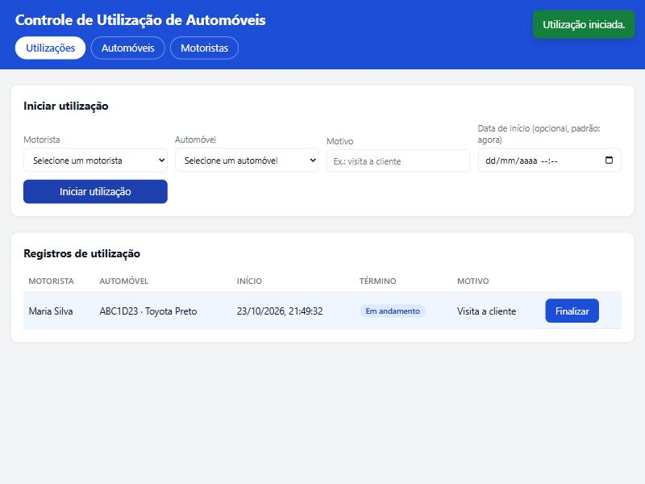

# Controle de Utilização de Automóveis — WebAPI

API REST em **Node.js + Express** para controlar a utilização dos automóveis de uma empresa:
cadastro de automóveis, cadastro de motoristas e registro de utilização (início, término e motivo),
com as regras de negócio que impedem um automóvel de ser usado por dois motoristas ao mesmo tempo
e um motorista de usar dois automóveis simultaneamente.

A persistência é **em memória** (os dados são perdidos ao reiniciar o servidor), conforme permitido
no enunciado do teste.

## Sumário

- [Início rápido](#início-rápido)
- [Funcionalidades](#funcionalidades)
- [Tecnologias](#tecnologias)
- [Como executar](#como-executar)
- [Interface web](#interface-web)
- [Como testar](#como-testar)
- [Endpoints](#endpoints)
- [Regras de negócio](#regras-de-negócio)
- [Respostas de erro](#respostas-de-erro)
- [Estrutura do projeto](#estrutura-do-projeto)
- [Decisões de projeto](#decisões-de-projeto)

## Início rápido

Pré-requisito: Node.js 18 ou superior (com npm).

```bash
git clone https://github.com/ppBernardo/Teste-Seidor.git
cd Teste-Seidor
npm install
npm start
```

Depois abra `http://localhost:3000` para usar a interface web ou chame a API diretamente
(por exemplo, `curl http://localhost:3000/automoveis`). Para rodar os testes: `npm test`.

## Funcionalidades

| Requisito do teste                                                          | Onde está                                   |
| --------------------------------------------------------------------------- | ------------------------------------------- |
| Cadastrar, atualizar, excluir e recuperar automóvel por id                  | `POST`, `PUT`, `DELETE`, `GET /automoveis/:id` |
| Listar automóveis filtrando por cor e marca                                 | `GET /automoveis?cor=&marca=`               |
| Cadastrar, atualizar, excluir e recuperar motorista por id                  | `POST`, `PUT`, `DELETE`, `GET /motoristas/:id` |
| Listar motoristas filtrando por nome                                        | `GET /motoristas?nome=`                     |
| Criar registro de utilização (motorista, automóvel, data de início, motivo) | `POST /utilizacoes`                         |
| Finalizar utilização guardando a data de término                            | `PATCH /utilizacoes/:id/finalizar`          |
| Listar utilizações com nome do motorista e dados do automóvel               | `GET /utilizacoes`                          |
| Um automóvel só pode ser utilizado por um motorista por vez                 | Regra em `UtilizacaoService` (responde 409) |
| Um motorista não pode utilizar dois automóveis ao mesmo tempo               | Regra em `UtilizacaoService` (responde 409) |
| Persistência em memória                                                     | `InMemoryRepository`                        |
| Testes de unidade                                                           | `npm test` (Jest + Supertest)               |

## Tecnologias

| Item          | Versão / observação                              |
| ------------- | ------------------------------------------------ |
| Node.js       | 18 ou superior (desenvolvido com Node 24)        |
| Express       | 5.x                                              |
| Jest          | 30.x — testes unitários e de integração          |
| Supertest     | 7.x — requisições HTTP nos testes de integração  |

Sem banco de dados e sem variáveis de ambiente obrigatórias.

## Como executar

```bash
npm install
npm start
```

O servidor sobe em `http://localhost:3000`. Para usar outra porta:

```bash
PORT=4000 npm start
```

Para desenvolvimento, com reinício automático a cada alteração nos arquivos:

```bash
npm run dev
```

## Interface web

Com o servidor no ar, abra `http://localhost:3000` no navegador. A pasta [`frontend/`](frontend/)
contém uma interface simples em HTML, CSS e JavaScript puro (sem framework e sem etapa de build),
servida como arquivos estáticos pelo próprio Express, por isso não precisa de CORS nem de outro
servidor. Ela cobre todas as funcionalidades da API em três abas:



- **Utilizações**: iniciar uma utilização escolhendo motorista e automóvel, informar o motivo e,
  opcionalmente, a data de início; listar os registros com o nome do motorista e os dados do
  automóvel; finalizar os que estão em andamento.
- **Automóveis**: cadastrar, editar, excluir e filtrar por cor e marca.
- **Motoristas**: cadastrar, editar, excluir e filtrar por nome.

As mensagens de erro da API (campos inválidos e regras de negócio) são exibidas na própria tela.

Passo a passo sugerido para experimentar:

1. Na aba **Motoristas**, cadastre um motorista (ex.: "Maria Silva").
2. Na aba **Automóveis**, cadastre um automóvel (ex.: placa `ABC1D23`, cor Preto, marca Toyota).
3. Na aba **Utilizações**, escolha o motorista e o automóvel, informe o motivo e clique em
   **Iniciar utilização**. O registro aparece na tabela como "Em andamento".
4. Tente iniciar outra utilização com o mesmo motorista ou com o mesmo automóvel: a regra de
   negócio é aplicada e o aviso de erro aparece no canto da tela.
5. Clique em **Finalizar** na linha do registro para gravar a data de término.

## Como testar

```bash
npm test
```

Com relatório de cobertura (gerado também em `coverage/lcov-report/index.html`):

```bash
npm run test:coverage
```

Os testes estão em `tests/`:

- `tests/unit/` — testes unitários do repositório em memória e dos três serviços, incluindo todas
  as validações e regras de negócio (cada caso roda com repositórios novos, sem estado compartilhado).
- `tests/integration/` — testes das rotas HTTP com Supertest, cobrindo códigos de status, formato
  das respostas, filtros, erros e o fluxo completo de utilização.

Para testes manuais, o arquivo [`requests.http`](requests.http) tem exemplos prontos de todas as
rotas (compatível com a extensão *REST Client* do VS Code), e a seção de endpoints abaixo traz
exemplos com `curl`.

## Endpoints

Todas as rotas recebem e devolvem JSON. Datas são aceitas em ISO 8601 e devolvidas em UTC
(`2026-10-23T08:00:00.000Z`). Identificadores são UUIDs gerados pelo servidor.

### Automóveis — `/automoveis`

| Método   | Rota                              | Descrição                                   | Sucesso |
| -------- | --------------------------------- | ------------------------------------------- | ------- |
| `POST`   | `/automoveis`                     | Cadastra um automóvel                       | 201     |
| `GET`    | `/automoveis?cor=&marca=`         | Lista automóveis, com filtros opcionais     | 200     |
| `GET`    | `/automoveis/:id`                 | Recupera um automóvel pelo id               | 200     |
| `PUT`    | `/automoveis/:id`                 | Atualiza os campos enviados                 | 200     |
| `DELETE` | `/automoveis/:id`                 | Exclui um automóvel                         | 204     |

Campos: `placa`, `cor`, `marca` (todos obrigatórios no cadastro). A placa é guardada em maiúsculas
e não pode se repetir. Os filtros `cor` e `marca` comparam o valor completo sem diferenciar
maiúsculas de minúsculas e podem ser combinados.

```bash
curl -X POST http://localhost:3000/automoveis \
  -H "Content-Type: application/json" \
  -d '{"placa":"ABC1D23","cor":"Preto","marca":"Toyota"}'
```

```json
{ "id": "7a0d4d3e-...", "placa": "ABC1D23", "cor": "Preto", "marca": "Toyota" }
```

```bash
curl "http://localhost:3000/automoveis?cor=preto&marca=toyota"
curl -X PUT http://localhost:3000/automoveis/<id> -H "Content-Type: application/json" -d '{"cor":"Azul"}'
curl -X DELETE http://localhost:3000/automoveis/<id>
```

### Motoristas — `/motoristas`

| Método   | Rota                       | Descrição                                   | Sucesso |
| -------- | -------------------------- | ------------------------------------------- | ------- |
| `POST`   | `/motoristas`              | Cadastra um motorista                       | 201     |
| `GET`    | `/motoristas?nome=`        | Lista motoristas, com filtro opcional       | 200     |
| `GET`    | `/motoristas/:id`          | Recupera um motorista pelo id               | 200     |
| `PUT`    | `/motoristas/:id`          | Atualiza o nome                             | 200     |
| `DELETE` | `/motoristas/:id`          | Exclui um motorista                         | 204     |

Campo: `nome` (obrigatório). O filtro `nome` aceita um trecho do nome, sem diferenciar maiúsculas
de minúsculas (`?nome=mar` encontra "Maria" e "Mariana").

```bash
curl -X POST http://localhost:3000/motoristas \
  -H "Content-Type: application/json" \
  -d '{"nome":"Maria Silva"}'
```

### Utilizações — `/utilizacoes`

| Método  | Rota                           | Descrição                                                        | Sucesso |
| ------- | ------------------------------ | ---------------------------------------------------------------- | ------- |
| `POST`  | `/utilizacoes`                 | Inicia a utilização de um automóvel por um motorista             | 201     |
| `PATCH` | `/utilizacoes/:id/finalizar`   | Finaliza a utilização, gravando a data de término                | 200     |
| `GET`   | `/utilizacoes`                 | Lista as utilizações com o nome do motorista e dados do automóvel | 200     |
| `GET`   | `/utilizacoes/:id`             | Recupera uma utilização pelo id                                  | 200     |

Corpo do `POST`: `motoristaId`, `automovelId` e `motivo` (obrigatórios) e `dataInicio`
(opcional; se omitida, usa o momento atual). Corpo do `PATCH`: `dataTermino` (opcional; se omitida,
usa o momento atual).

```bash
curl -X POST http://localhost:3000/utilizacoes \
  -H "Content-Type: application/json" \
  -d '{"motoristaId":"<id do motorista>","automovelId":"<id do automóvel>","motivo":"Visita a cliente"}'
```

```json
{
  "id": "21292db3-...",
  "dataInicio": "2026-10-23T08:00:00.000Z",
  "dataTermino": null,
  "motivo": "Visita a cliente",
  "motorista": { "id": "280d93c1-...", "nome": "Maria Silva" },
  "automovel": { "id": "48a2ad95-...", "placa": "ABC1D23", "cor": "Preto", "marca": "Toyota" }
}
```

```bash
curl -X PATCH http://localhost:3000/utilizacoes/<id>/finalizar \
  -H "Content-Type: application/json" \
  -d '{"dataTermino":"2026-10-23T09:30:00.000Z"}'
curl http://localhost:3000/utilizacoes
```

## Regras de negócio

Uma utilização está **em andamento** enquanto não tiver `dataTermino`. Com base nisso:

1. **Um automóvel só pode ser utilizado por um motorista por vez.** Tentar iniciar uma utilização
   de um automóvel em andamento devolve `409`.
2. **Um motorista que já esteja utilizando um automóvel não pode utilizar outro ao mesmo tempo.**
   Tentar iniciar uma segunda utilização para o mesmo motorista devolve `409`.

Validações complementares adotadas para manter os dados consistentes:

- A placa do automóvel é única (`409` em caso de duplicidade).
- Automóvel ou motorista com utilização em andamento não pode ser excluído (`409`).
- Uma utilização já finalizada não pode ser finalizada de novo (`409`).
- A data de término não pode ser anterior à data de início (`400`).

## Respostas de erro

Toda resposta de erro tem o formato `{ "erro": "mensagem legível" }`.

| Status | Quando                                                                         |
| ------ | ------------------------------------------------------------------------------ |
| 400    | Campo obrigatório ausente, formato inválido, data inválida ou JSON malformado  |
| 404    | Recurso não encontrado (inclui ids de motorista/automóvel usados na utilização) |
| 409    | Violação de regra de negócio                                                   |
| 500    | Erro inesperado (detalhes vão para o log do servidor, não para o cliente)      |

## Estrutura do projeto

```
src/
  app.js            # monta o Express e injeta as dependências (criarApp)
  server.js         # ponto de entrada: sobe o servidor na porta configurada
  errors/           # AppError e subclasses, cada uma com seu status HTTP
  utils/            # funções de validação reutilizadas pelos serviços
  repositories/     # InMemoryRepository: persistência em memória genérica
  services/         # regras de negócio (AutomovelService, MotoristaService, UtilizacaoService)
  controllers/      # traduzem requisição HTTP em chamada ao serviço e vice-versa
  routes/           # definição das rotas de cada recurso
  middlewares/      # tratamento centralizado de erros e rota não encontrada
frontend/
  index.html        # interface web: abas de utilizações, automóveis e motoristas
  styles.css        # estilos da interface
  app.js            # chamadas à API e atualização das telas
tests/
  unit/             # repositório e serviços
  integration/      # rotas HTTP com Supertest
docs/interface.jpg  # captura da interface usada neste README
requests.http       # exemplos de requisições para testes manuais
```

## Decisões de projeto

- **Camadas separadas** (rotas → controllers → serviços → repositórios). As regras de negócio
  ficam nos serviços, que não conhecem HTTP; os controllers são finos.
- **Injeção de dependência manual** em `criarApp()`. Cada teste cria uma aplicação nova com estado
  limpo, e trocar o repositório em memória por um banco real no futuro não exige mexer nos serviços.
- **Repositório genérico**: um único `InMemoryRepository` atende os três recursos e devolve cópias
  dos registros, evitando que o estado interno seja alterado por fora.
- **Erros tipados** (`ValidationError`, `NotFoundError`, `BusinessRuleError`) convertidos em resposta
  por um único middleware, sem `try/catch` espalhado pelo código.
- **Atualização parcial** no `PUT`: apenas os campos enviados são alterados, com ao menos um
  campo válido obrigatório.
- **Frontend servido pelo Express** como arquivos estáticos: uma única porta, sem CORS e sem
  build. Os arquivos ficam isolados em `frontend/`, e a API continua funcionando sem eles.
- **Utilização guarda só os ids** de motorista e automóvel e junta os dados na leitura. Se um
  cadastro for excluído depois de a utilização ter sido finalizada, o campo correspondente vem
  como `null` em vez de quebrar a listagem.
